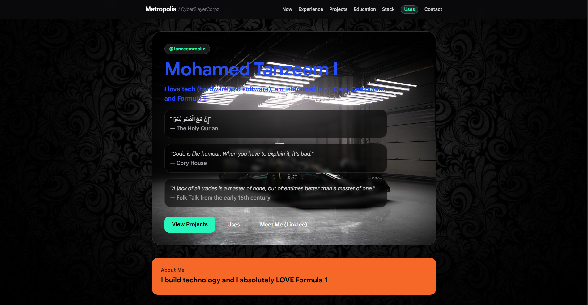

# Metropolis — tanzeem.xyz

Personal portfolio, systems engineering lab, and hardware showcase of **Mohamed Tanzeem I** ([@tanzeemrockz](https://github.com/tanzeemrockz)), Founder of **CyberSlayerCorpz**.



## Tech Stack & Architecture

- **Core**: Semantic HTML5, CSS3, Vanilla JavaScript (ESNext).
- **Styling**: Tailwind CSS CDN with custom dark palette tokens:
  - `--color-green`: `#27F5BB` (Neon Mint)
  - `--color-blue`: `#274DF5` (Electric Blue)
  - `--color-orange`: `#F56827` (Kinetic Orange)
  - `--color-yellow`: `#F5CF27` (Telemetry Speed Yellow)
- **Typography**: Google Sans, Google Sans Text, Noto Sans Arabic, and JetBrains Mono.
- **Deployment**: Optimized for Vercel with zero-configuration static serving (`vercel.json`).

## Structure

```
tanzeem.xyz/
├── index.html       # Flagship portfolio page
├── style.css        # Custom styles, glassmorphism, glowing telemetry, and fonts
├── main.js          # Interactive quote switcher, tech filter, toast & F1 DRS trigger
├── favicon.svg      # Geometric CyberSlayer shield badge
├── vercel.json      # Security headers & clean URLs configuration
├── img/             # Photography, banner backgrounds, and preview artwork
└── uses/
    └── index.html   # Living setup inventory: laptops, vintage testbench, and AI stack
```

## Local Development

Open `index.html` directly in any web browser, or run a local static server:

```bash
npx serve .
```

## Operator

- **Founder**: Mohamed Tanzeem I ([@tanzeemrockz](https://github.com/tanzeemrockz))
- **Organization**: [CyberSlayerCorpz](https://cyberslayercorpz.dev)
- **Direct Email**: `tanzeemrockz@cyberslayercorpz.dev`
